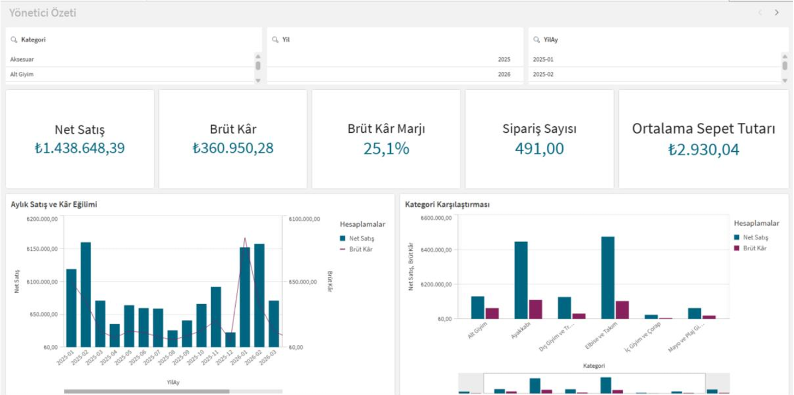
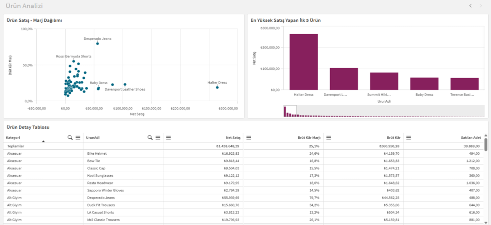

# Perakende Satış ve Kârlılık Analizi

Data Talent Bootcamp kapsamında **Qlik Sense Desktop** kullanılarak hazırlanmış bir perakende satış ve kârlılık analizi projesidir.

Projede 1 Ocak 2025 – 31 Ağustos 2026 dönemine ait satış verileri incelenerek genel satış performansı, kârlılık, sipariş hacmi ve ürün/kategori performansı değerlendirilmiştir.

## Projenin Amacı

- Temel KPI'lar aracılığıyla satış ve kârlılık performansını takip etmek.
- Aylık net satış ve brüt kâr eğilimlerini incelemek.
- Kategorilerin net satış ve brüt kâra katkılarını karşılaştırmak.
- En yüksek ve en düşük satış performansına sahip ürünleri belirlemek.
- Yüksek satış hacmine rağmen görece düşük kâr marjına sahip ürünleri tespit etmek.
- 2025 ve 2026 yıllarının Ocak–Ağustos dönemlerini karşılaştırmak.

## Dashboard Sayfaları

Qlik Sense uygulaması iki ana sayfadan oluşmaktadır.

### 1. Yönetici Özeti

Genel satış ve kârlılık performansını temel göstergeler ve grafikler aracılığıyla sunar.

**Filtreler**
- Yıl
- Yıl-Ay
- Kategori

**KPI'lar**
- Net Satış
- Brüt Kâr
- Brüt Kâr Marjı
- Sipariş Sayısı
- Ortalama Sepet Tutarı

**Grafikler**
- Aylık Satış ve Kâr Eğilimi
- Kategori Karşılaştırması



### 2. Ürün Analizi

Ürünlerin satış ve kârlılık performansını ürün bazında incelemeye olanak sağlar.

**Görselleştirmeler**
- Ürün Satış – Brüt Kâr Marjı Dağılım Grafiği
- Net Satışa Göre En Yüksek 5 Ürün
- Ürün Performans Detay Tablosu



## Veri Modeli

Analiz iki temel tablo üzerinden gerçekleştirilmiştir:

- **Satış (`Satis`):** Satış hareketlerine ait verileri içerir.
- **Ürün (`Urun`):** Ürün bilgilerini içerir.

Tablolar, ortak **`UrunNo`** alanı üzerinden ilişkilendirilmiştir. Bu yapı sayesinde satış verileri ürün ve kategori bazında analiz edilebilmektedir.

## Kullanılan Temel Ölçüler

| Ölçü | Hesaplama |
|---|---|
| Net Satış | `Sum(Tutar)` |
| Toplam Maliyet | `Sum(Maliyet)` |
| Brüt Kâr | `Sum(Tutar) - Sum(Maliyet)` |
| Brüt Kâr Marjı | `(Sum(Tutar) - Sum(Maliyet)) / Sum(Tutar)` |
| Sipariş Sayısı | `Count(DISTINCT SiparisID)` |
| Ortalama Sepet Tutarı | `Sum(Tutar) / Count(DISTINCT SiparisID)` |
| Satılan Adet | `Sum(Adet)` |

## Öne Çıkan Bulgular

- Toplam net satış: **₺1.438.648,39**
- Toplam brüt kâr: **₺360.950,28**
- Brüt kâr marjı: **%25,1**
- Sipariş sayısı: **491**
- Ortalama sepet tutarı: **₺2.930,04**

Analiz kapsamında elde edilen diğer bulgular:

- En yüksek aylık net satış **Şubat 2025** döneminde ₺159.741,36; en düşük aylık net satış ise **Aralık 2025** döneminde ₺22.581,52 olarak gerçekleşmiştir.
- **Elbise ve Takım** kategorisi ₺474.578,33 ile net satışta ilk sıradadır.
- **Ayakkabı** kategorisi ₺109.802,41 ile brüt kârda ilk sıradadır.
- **Halter Dress**, ₺264.237,89 net satış ile en yüksek satışlı ürün olmasına rağmen %18,9 brüt kâr marjına sahiptir. Bu oran genel brüt kâr marjı olan %25,1'in altındadır.

### 2025–2026 Ocak–Ağustos Karşılaştırması

| Gösterge | 2025 | 2026 |
|---|---:|---:|
| Net Satış | ₺593.263,80 | ₺624.104,81 |
| Brüt Kâr | ₺141.685,16 | ₺172.526,17 |
| Sipariş Sayısı | 167 | 272 |
| Ortalama Sepet Tutarı | ₺3.552,48 | ₺2.294,50 |

2026 yılında net satış, brüt kâr ve sipariş sayısı artarken ortalama sepet tutarı azalmıştır. Bu durum, satışların daha fazla sipariş üzerinden gerçekleştiğini ancak sipariş başına ortalama tutarın düştüğünü göstermektedir.

## Değerlendirme ve Öneriler

- Halter Dress gibi yüksek satış hacmine sahip ancak görece düşük marjlı ürünlerde maliyet, fiyatlandırma ve kampanya etkileri incelenebilir.
- Elbise ve Takım kategorisinde satış hacmini korurken kâr marjını artırmaya; Ayakkabı kategorisinde ise mevcut kârlılığı destekleyecek satış fırsatlarına odaklanılabilir.
- Performans değerlendirmelerinde net satışın yanında brüt kâr, brüt kâr marjı, sipariş sayısı ve ortalama sepet tutarı birlikte takip edilmelidir.

## Proje Dosyaları

```text
retail-sales-profitability-analysis/
├── dashboard/
│   └── retail_sales_analysis.qvf
├── data/
│   └── veri-dosyasi.xlsx
├── screenshots/
│   ├── executive-summary-dashboard.png
│   └── product-analysis-dashboard.png
├── project-report.pdf
└── README.md
```

## Projeyi Açma

1. Qlik Sense Desktop uygulamasını açın.
2. `dashboard/retail_sales_analysis.qvf` dosyasını uygulamada açın.
3. Uygulama harici veri kaynağı isterse `data` klasöründeki Excel dosyasını göstererek veriyi yeniden yükleyin.

`.qvf` dosyası Qlik Sense uygulamasını içerir. Dashboard ekran görüntüleri ve proje raporu ise uygulamayı açmadan projeyi incelemek isteyenler için eklenmiştir.

## Kullanılan Araçlar

- Qlik Sense Desktop
- Microsoft Excel
